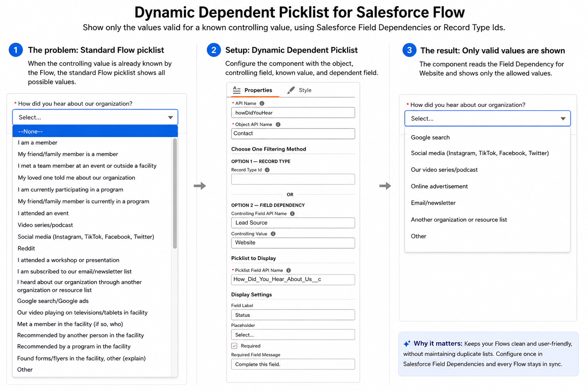

# Empowered Picklists for Salesforce Flow

A lightweight Salesforce Flow Screen Component that displays only the picklist values valid for either a specific Record Type or an existing Salesforce Field Dependency.

Use Salesforce's own picklist configuration as the source of truth without hard-coding choices in Flow.



## Why This Exists

Salesforce Flow doesn't always give you the picklist filtering behavior you need.

Sometimes you need to show only the values available for a specific **Record Type**. Other times, the Flow already knows the value of a **controlling field** and there's no reason to ask the user to select — or even see — that field.

For example, imagine an online form with:

- **Source:** Online
- **How Did You Hear About Us?:** a dependent picklist

If every submission from the form has a Source of `Online`, there's no reason to ask the user to select it.

Empowered Picklists can supply `Online` behind the scenes and display only the dependent picklist values Salesforce has configured as valid for `Online`.

Or, if a picklist has different values available for different Record Types, the component can display only the values available for the Record Type supplied by the Flow.

No hard-coded choices. No duplicate configuration. No trying to remember every Flow that needs to be updated when a picklist value changes.

Salesforce's existing picklist configuration remains the single source of truth.

## Features

- No Apex required
- Uses Salesforce UI API
- Supports **Record Type filtering**
- Supports existing Salesforce **Field Dependencies**
- Uses Salesforce picklist configuration as the single source of truth
- **Never hard-code filtered picklist values in your Flow**
- **No duplicate lists of choices to maintain**
- Works in Salesforce Screen Flows
- Returns the selected API value directly to Flow
- Supports same-screen reactive conditional visibility when the component output is referenced directly
- Supports required-field validation and a custom required-field message
- Provides configuration errors when fields or values are misconfigured
- Includes a custom Flow Builder property editor that clearly separates the two filtering methods

## Requirements

The picklist field must belong to the object specified in **Object API Name**.

For **Record Type filtering**, supply the Record Type Id whose available picklist values should be displayed.

For **Field Dependency filtering**, the controlling and dependent fields must already have a **Field Dependency relationship configured in Salesforce Object Manager**, and both fields must belong to the same object.

## Installation

### Install the Package

The easiest way to install Empowered Picklists is with the released unlocked package:

- **Production / Developer Edition:**  
  https://login.salesforce.com/packaging/installPackage.apexp?p0=04tfj000000mIU5AAM

- **Sandbox:**  
  https://test.salesforce.com/packaging/installPackage.apexp?p0=04tfj000000mIU5AAM

This installs **Empowered Picklists v1.0.1** and its Flow Builder configuration editor.

### Deploy from Source

If you prefer to deploy from source, copy both component folders:

```text
force-app/main/default/lwc/dynamicDependentPicklist
force-app/main/default/lwc/dynamicDependentPicklistEditor
```

into the same location in your Salesforce DX project.

Deploy both components with Salesforce CLI:

```bash
sf project deploy start --source-dir force-app/main/default/lwc/dynamicDependentPicklist --source-dir force-app/main/default/lwc/dynamicDependentPicklistEditor
```

After deployment, **Empowered Picklists** will be available as a Screen Component in Flow Builder.

The `dynamicDependentPicklistEditor` component is used automatically when configuring Empowered Picklists in Flow Builder. It does not appear as a separate Flow Screen Component.

## Flow Configuration

Add **Empowered Picklists** to a Flow Screen.

### Object API Name

API name of the object containing the picklist field.

Example:

```text
Contact
```

### Choose One Filtering Method

#### Option 1 — Record Type

Enter a **Record Type Id** to display only the picklist values available for that Record Type.

Leave **Controlling Field API Name** and **Controlling Value** blank.

#### Option 2 — Field Dependency

Enter the **Controlling Field API Name** and **Controlling Value** from an existing Salesforce Field Dependency.

The controlling value must be the picklist value's **API value**, not its label if those differ.

The controlling field itself is not displayed to the user.

### Picklist Field API Name

API name of the picklist field whose filtered values should be displayed.

### Display Settings

- **Field Label** — label displayed above the picklist.
- **Placeholder** — text displayed before the user selects a value.
- **Required** — determines whether the user must select a value before proceeding.
- **Required Field Message** — custom validation message displayed when Required is enabled and no value is selected.

## Selected Value

The component outputs the selected picklist's **API value** to Flow.

Reference **Selected Value directly from the component** wherever you need it in the Flow, including:

- reactive conditional visibility on the same screen
- Decisions or Assignments later in the Flow
- Create Records or Update Records field mappings

You do **not** need to assign Selected Value to a separate Flow variable. Using the component output directly preserves same-screen reactivity and keeps the selected value available later in the Flow.

## Record Type Example

Suppose the available values for a Contact picklist vary by Record Type.

Configure Empowered Picklists with:

```text
Object API Name:
Contact

Record Type Id:
{!recordTypeId}

Picklist Field API Name:
Interest__c
```

The user sees only the **Interest** values Salesforce has made available for that Record Type.

No controlling field or Field Dependency is required.

If the available picklist values for the Record Type are later changed in Salesforce, the component automatically uses the updated configuration.

## Field Dependency Example

Suppose a Flow-powered online form always uses:

```text
Source__c = Online
```

And Salesforce has a Field Dependency between:

```text
Source__c
        ↓
How_did_you_hear_about_us__c
```

Configure Empowered Picklists with:

```text
Object API Name:
Contact

Controlling Field API Name:
Source__c

Controlling Value:
Online

Picklist Field API Name:
How_did_you_hear_about_us__c
```

The user sees only the **How Did You Hear About Us?** values Salesforce has configured as valid when Source is `Online`.

If the Field Dependency is later changed in Object Manager, the component automatically uses the updated configuration. There is no second list of choices to maintain in the Flow.

## Guest User / Experience Cloud Note

This component retrieves object and picklist metadata using Salesforce UI API.

When used in a public or unauthenticated Experience Cloud site, the guest user must have sufficient access for Salesforce to return the relevant object and field metadata.

Always test the component in the same user context in which the Flow will run.

## License

MIT
